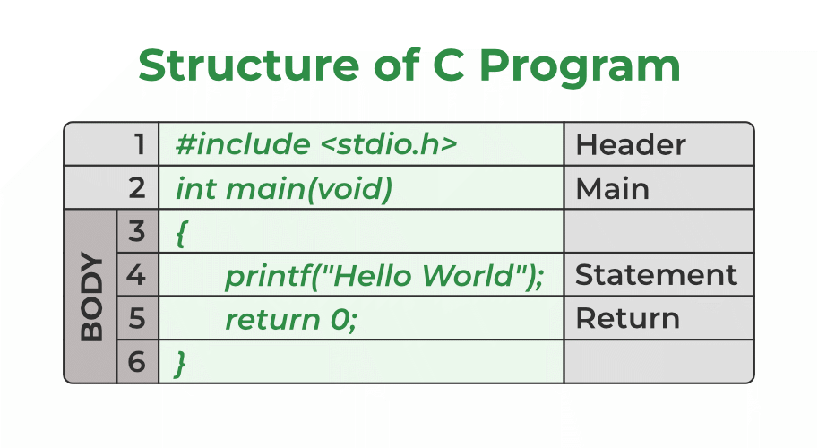
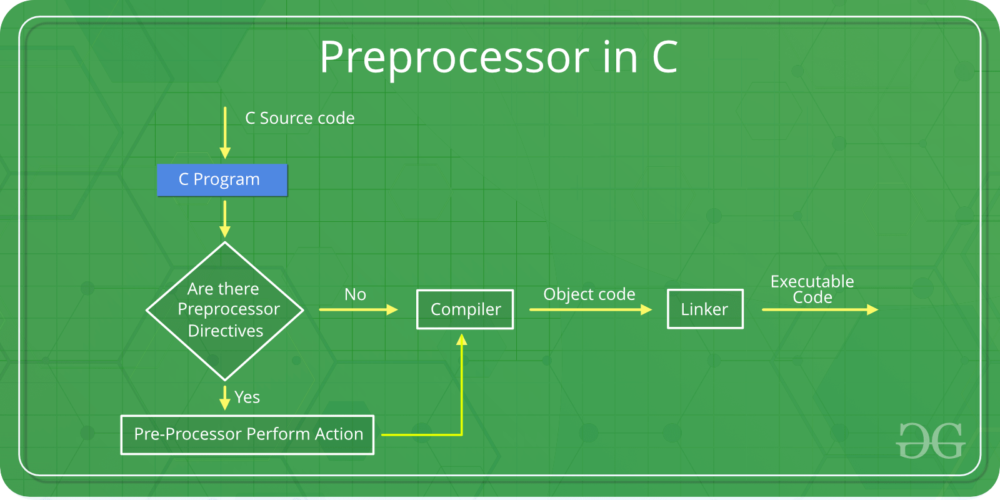

C is a procedural programming language. It was developed by Dennis Ritchie at the Bell Laboratories in the year 1972. Despite being old C is a very popular language among programmers. It is a very fast language compared to other languages like Python, Java, etc.

Below is the basic syntax structure of the C program:

_**The basic syntax of the C program consists of the header, main() function, variable declaration, body, and return type of the program.**_

- The header is the first line in the C program with extension .h which contains macro definitions and C functions. 
- Programs must contain the main() function because execution in C programming starts from the main().
- Variable declaration in C is done inside the main function and can be used in the body anywhere but before the main, we can also declare variables which are known as Global variables. 
- In the body of the function, we perform operations required inside the function like printing, sum, average, sorting, searching, etc.
- The last part of the C program is the return statement which refers to returning values of the program. If the return type is void then there will be no return statement.

## Tokens

A token in C programming is either a keyword, an identifier, a constant, a string literal, or a symbol. Let's get a good understanding of tokens through a print statement in C language.
- printf("GeeksforGeeks\n");

## Semicolons

In C programming Semicolon is used to show the termination of Instruction. It is also called a statement terminator since every single statement should be ended with a semicolon. Semicolons are used to end statements in C.

The Semicolon tells the compiler that the current statement has been terminated. If any statement in the Program ends without a semicolon, then the program will not compile and will generate an error message.

#include <stdio.h>
int main()
{
	 printf("Hello world!\n"); -------Semicolon
	 return 0;------------------------semicolon
}

## Preprocessor Directives

In C language, a program should begin with Preprocessor Directives since they contain multiple files that contain specific functions. Preprocessors in C are used to process our source code before compilation.

There are _**4 main types of Preprocessor directives in C:**_

1. Macros
2. File inclusion
3. Conditional Compilation
4. Other directives

While executing a program in C multiple steps are involved as mentioned below:

## Identifiers in C

In C programming, the identifier is used to identify a variable, function, or any other user-defined data type. C programming language does not allow special characters such as $, @, or % within the identifier.

C is a case-sensitive programming language which means that "geeksforgeeks" and "Geeksforgeeks" are treated as two different identifiers in C. Identifiers should begin with a letter Uppercase letters (A to Z), lowercase letters (a-z), digits (0-9) or underscores ( _ ).

**Some examples of identifiers in C are:**
- geeks
- Geek
- geek12
- _geek
- GEEKSFORGEEKS
- g23gf9

## C Keywords

In the C programming language, keywords are reserved words that have special meanings. These reserved words can't be used as variables or constants or any other identifier name. C contains a total of 32 keywords that are reserved and have special meanings.

**Keywords in C programming are mentioned below:**
- int          long          short          signed          unsigned          void
- char       break        register      structure       class                 volatile
- while      for            switch        typedef         union               static
- auto       return       case           const            continue          default
- do          double     else             if                   enum              extern
- float       goto

## Comments in C

In C programming comments are used to make any program more readable and understandable. Comments are generally used by programmers to add explanations or descriptive text in the code without any interference from the compiler or the programming structure.

Comments are not programming statements and they are ignored by the compiler. We can't have comments inside comments since they will interfere within themselves.

**In C language there are two types of programming comments:**

- **Single-line Comments:** Single-line comments begin with // and they are only used for a single line and end in the next line.
- **Multiline Comments:** Multi-line comments start with /* and end with */. They can be a single line or multiline.

## Whitespaces in C

In C programming lines containing white spaces, blank lines, and comments are ignored by the compiler. Whitespace in C is used to describe blanks, newline characters, comments, and tabs.

Whitespace is used to separate parts of a statement from another and it helps the compiler to distinguish the keywords, identifiers, and elements in a statement. It allows us to format our code in a way that makes it easier to understand by programmers and others. In C we are free to use the whitespaces to increase user readability.

**Example of Whitespace in C:**
int a;
// whitespace used to increase readablity and to distinguish elements.
string s = "GeeksforGeeks";

## Functions

In C programming Function is a set of statements that performs specific computations. Functions help us to reduce our code redundancy. Instead of writing multiple lines of code again and again we use functions to reduce code redundancy.

Functions in C provide abstractions. In C "main" is also a function that has its own return type defined in the program. This function serves as the starting point for program execution.

**Example**
int **mul**(int _Full_marks_,int _Full_marks2_);

**Below is the representation of the above C function:**
